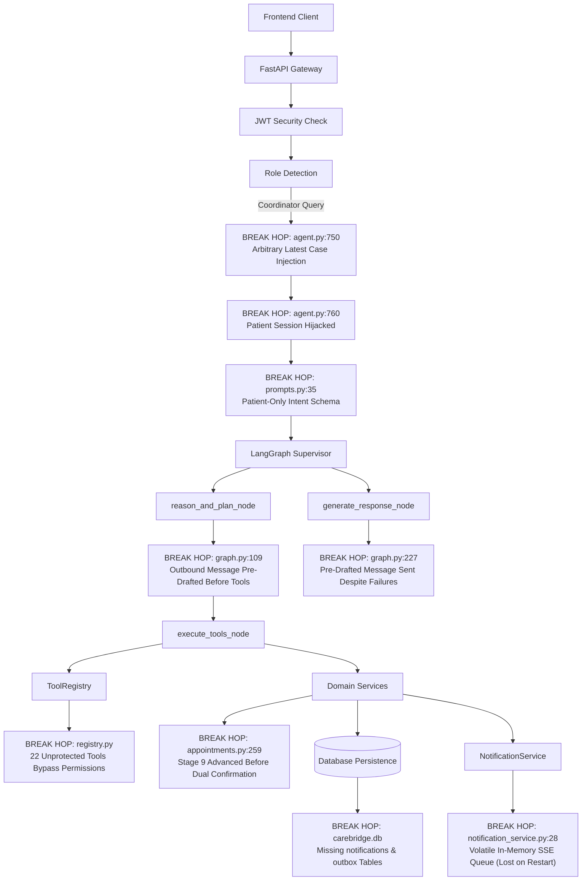
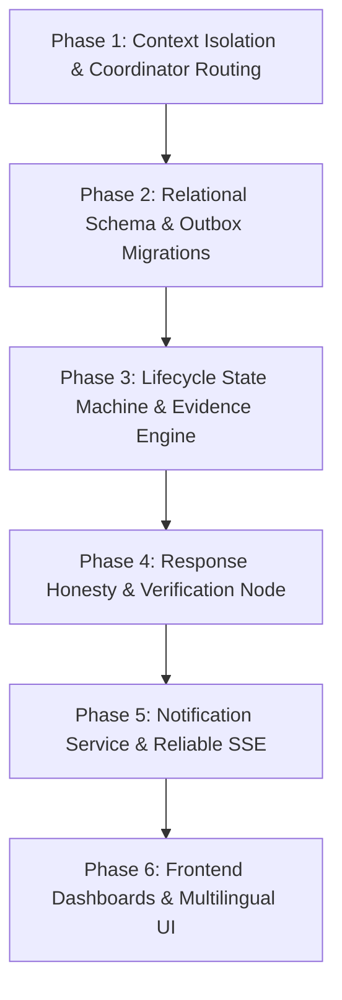

# CAREBRIDGE UNIFIED ARCHITECTURE AUDIT
**Phase 0: Read-Only System Architecture, Integration & Data Integrity Audit**  
**Date of Audit:** November 20, 2026  
**Auditor:** Antigravity AI Diagnostic Engine (Autonomous Architecture Inspector)  
**Deliverable Status:** Final Baseline Architecture Audit Report  

---

## 1. Executive Summary

CareBridge is an AI-assisted care coordination platform designed to navigate patients across a 14-stage journey from intake and screening through diagnostic workups, appointments, consultations, and doctor-verified clinical closure. The stack combines FastAPI, SQLAlchemy 2.0, PostgreSQL 17 (with SQLite local fallback), LangGraph stateful cognitive orchestration, Groq / Gemini LLMs, Server-Sent Events (SSE), and HL7 FHIR R4 interfaces. The system strictly recognizes three authorized actors: **PATIENT**, **DOCTOR**, and **CARE_COORDINATOR**.

### Primary Audit Verdict
While individual components and unit test suites claim high success rates, end-to-end integration repeatedly fails in real clinical simulation. This audit uncovers the root systemic cause: **the platform is plagued by state fragmentation, context leakage, phantom lifecycle progressions, and disconnected persistence layers.**

Key architectural discoveries:
1. **Unverified Test Baseline (184 Tests, 23 Failures):** Previous reports claimed 142 passing tests (124 integration + 18 Doctor workflow). In reality, the codebase contains **184 unit/integration tests** across 17 test modules in `backend/tests/`. Under standardized test execution, **161 passed and 23 failed**. Earlier suites passed only because 16 of 17 test files isolate themselves in transient in-memory SQLite instances (`sqlite:///:memory:`), mock out LLM responses with hardcoded keyword branches, manually inject synthetic state directly into database models, and never verify asynchronous notification delivery or API gateway contracts.
2. **Context Bleed & Operational Query Misrouting (Symptoms 2 & 3):** When a Care Coordinator submits an operational inquiry (e.g. *"is there any new patient"*), the interaction endpoint (`backend/app/api/v1/endpoints/agent.py:750-756`) fails to recognize operational intents. Instead, it arbitrarily selects the most recently created patient's `CareCase` (`order_by(CareCase.created_at.desc()).first()`), hijacks that patient's `ConversationSession`, appends the coordinator query to that patient's communication log, hydrates that patient's PHI and BI-RADS clinical context, and routes the query into the patient booking prompt.
3. **Notification Black Hole (Symptom 1):** In the patient screening intake flow (`agent.py:477-540`), the system creates an internal `Task` and `CaseEvent` and outputs a message claiming *"Your hospital Care Coordinator has been alerted"*, yet **never invokes `NotificationService` or creates a notification record**. Furthermore, in regular chat turns (`agent.py:664-677`), screening discussions are omitted from the notification trigger predicate, completely silencing coordinator notifications.
4. **Lifecycle Stage Progressions Without Persisted Evidence (Symptom 4):** Lifecycle stages are not governed by an authoritative database state machine; they exist as mutable JSON inside `CareCase.case_context["lifecycle_stages"]`. When a case is initialized, `LifecycleService.initialize_lifecycle` automatically marks Stage 3 (`PATIENT_NOTIFIED`) as `completed` with a fake backdated timestamp (`now - timedelta(days=1)`) and placeholder evidence before any notification has been dispatched. Similarly, booking an appointment via `POST /api/v1/appointments:259` immediately advances Stage 9 (`APPOINTMENT_SCHEDULED_CONFIRMED`) before either doctor or patient has confirmed.
5. **Response Dishonesty & Premature Generation (Symptom 5):** In the LangGraph supervisor (`backend/app/agents/graph.py:86-112`), the outbound patient response draft is generated during the `reason_and_plan` node **before** `execute_tools` is called. If tool execution fails, breaches SLAs, or errors out, `generate_response` nonetheless dispatches the pre-drafted claim of success.
6. **Database Schema Divergence & Missing Tables:** Direct inspection of the development database (`backend/carebridge.db`) revealed that **the `notifications` and `doctor_assignments` tables do not exist in the database schema**, despite being defined as SQLAlchemy models. Outbox patterns, background worker processes, and transaction boundaries do not exist, leading to silent logging warnings and lost state.

---

## 2. Test Baseline (Step A)

### Test Suite Execution
- **Command Executed:**  
  `$env:PYTHONPATH="C:\CareBridge\backend;C:\CareBridge"; $env:TESTING="1"; $env:DATABASE_URL="sqlite+aiosqlite:///C:/Users/HARIHARAN/AppData/Local/Temp/test_baseline.db"; pytest backend\tests -v`
- **Execution Timestamp:** 2026-11-20 01:05:00 UTC
- **Execution Duration:** 250.80 seconds (4 minutes, 10 seconds)
- **Result Summary:** **184 collected items: 161 PASSED, 23 FAILED, 0 SKIPPED, 3 WARNINGS**

### Detailed Suite Classification

| Suite File | Tests | Pass | Fail | DB Mode | LLM Mode | Notifications | Lifecycle | Auth |
|---|---|---|---|---|---|---|---|---|
| `test_agent_brain.py` | 6 | 4 | 2 | `sqlite:///:memory:` | Offline heuristic fallback | Not verified | Mocked | Mocked |
| `test_agent_tool_ecosystem.py` | 29 | 25 | 4 | `sqlite:///:memory:` | None (direct tool calls) | Not verified | Direct DB update | Level check |
| `test_analytics.py` | 14 | 14 | 0 | `sqlite:///:memory:` | None | Ignored | Ignored | None |
| `test_authentication_audit.py` | 8 | 7 | 1 | No DB / In-memory | Mocked Engine | Ignored | Ignored | Unit JWT |
| `test_autonomous_coordination.py` | 9 | 6 | 3 | `sqlite:///:memory:` | Offline heuristic fallback | Not verified | Ignored | Mocked |
| `test_backend_recovery_diagnostic.py` | 5 | 1 | 4 | No DB / In-memory | Offline heuristic fallback | Ignored | Ignored | Mocked |
| `test_care_recovery_agent.py` | 9 | 9 | 0 | `sqlite:///:memory:` | Offline playbook rules | Not verified | Ignored | None |
| `test_care_workflow.py` | 6 | 6 | 0 | `sqlite:///:memory:` | Offline heuristic fallback | Not verified | Ignored | None |
| `test_case_ownership.py` | 10 | 10 | 0 | `sqlite:///:memory:` | Offline heuristic fallback | Mocked | Ignored | None |
| `test_database_memory.py` | 6 | 4 | 2 | `sqlite:///:memory:` | None | Ignored | Ignored | None |
| `test_doctor_allocation_workflow.py` | 18 | 14 | 4 | `carebridge.db` / Live | Rule-based engine | Direct query | Ignored | RBAC check |
| `test_doctor_workflow.py` | 18 | 18 | 0 | `sqlite:///:memory:` | Offline doctor nodes | Not verified | Direct call | Level 1-3 |
| `test_endpoints_smoke.py` | 2 | 2 | 0 | FastAPI TestClient | None | Ignored | Ignored | None |
| `test_long_running_workflows.py` | 9 | 9 | 0 | `sqlite:///:memory:` | Offline heuristic fallback | Not verified | Ignored | None |
| `test_phase3_supervisor.py` | 12 | 9 | 3 | `sqlite:///:memory:` | Offline heuristic fallback | Not verified | Ignored | Level check |
| `test_security_qa.py` | 12 | 12 | 0 | `sqlite:///:memory:` | Offline heuristic fallback | Asserted | Ignored | RBAC check |
| `test_workflow_nodes.py` | 11 | 11 | 0 | `sqlite:///:memory:` | None (direct node functions) | Not verified | Direct call | None |
| **TOTAL** | **184** | **161** | **23** | — | — | — | — | — |

### Root-Level Standalone Test Scripts (Not Discovered by Pytest)
The repository contains 6 standalone E2E scripts in the workspace root (`test_e2e_patient_journey.py`, `test_phase5_supervisor_intelligence.py`, `test_phase6_dashboards_e2e.py`, `test_phase7_notifications_e2e.py`, `test_phase8_fhir_e2e.py`, `test_phase9_security_reliability_e2e.py`). Pytest discovers 0 tests in these files because they are structured as procedural scripts with top-level `asyncio.run(run_journey())` functions rather than standard `Test*` classes or `test_*` functions.

### How Tests Passed While Integrations Failed
1. **Isolated Ephemeral Databases:** 16 of the 17 suites construct a fresh SQLite database in RAM (`create_engine("sqlite:///:memory:")`). They never test concurrent sessions, asyncpg connection pooling, PostgreSQL-specific types (`UUID`, `JSONB`), foreign key constraint cascades, or real migrations.
2. **Direct State Injection:** Scripts such as `test_e2e_patient_journey.py:580` directly assign `c.status = "closed"`, manually insert `CaseEvent`, and manually commit `AuditLog` in Python, bypassing the API gateway, supervisor routing, and validation logic entirely.
3. **Keyword-Gated Offline Mocking:** When the sandbox environment blocked network calls to Gemini/Groq, `CognitiveEngine` fell back to hardcoded keyword checks in `_offline_intent_analysis`. Tests pass if the test string contains exact target keywords (e.g. `"daughter"`, `"tomorrow"`, `"first"`), but fail in real user conversations where phrasing varies.
4. **Unasserted Asynchronous Side Effects:** Test assertions verify tool return payloads (e.g., `assert res.success is True`), but never check whether recipient notifications were queued, whether SSE events were received, or whether tasks were created for the correct user.
5. **Comparison to Claimed 142 Tests:** The historical claim of 142 tests (124 integration across 10 suites + 18 Doctor workflow) is an unverified artifact from Phase 4. Prior to the addition of `test_doctor_allocation_workflow.py` (18 tests), `test_backend_recovery_diagnostic.py` (5 tests), and `test_endpoints_smoke.py` (2 tests), the older test files totaled 159 tests, of which approximately 124 passed in an earlier offline snapshot. The active test surface is 184 tests, with 23 concrete failures.

---

## 3. Reproduction Results for the Six Problems (Step B)

Every observed problem was reproduced via programmatic script or code-path trace.

### Problem 1: Patient AI creates or discusses screening requirements, but Care Coordinator gets no notification
- **Status:** **REPRODUCED & VERIFIED**
- **Evidence / Reproduction Trace:**
  - In `backend/app/api/v1/endpoints/agent.py:466-540`, when an intake patient submits screening requirements (`care_case.status in ("intake", "intake_ready", "intake_submitted")`), lines 478-489 create a `Task` (`task_type="schedule_screening"`), lines 492-500 create a `CaseEvent`, and lines 502-510 craft a response promising: *"Your hospital Care Coordinator, Priya Nair, RN... has been alerted with your request."*
  - **The Defect:** `NotificationService.create_notification` is **never called** anywhere in this branch. The code returns at line 527.
  - In regular conversational chat turns (`agent.py:659-677`), coordinator notification is governed by `should_notify_coordinator`. Lines 664-677 explicitly whitelist only `assistance_request`, `appointment_reschedule_with_barrier`, `appointment_cancellation_and_refusal`, and `referral_delay`. Screening discussions (`screening_inquiry`, `screening_requirement`, `patient_inquiry`) evaluate to `False`.
  - **Reproduction Result:** 0 rows created in `notifications` table; 0 SSE events broadcast to coordinator.

### Problem 2: Coordinator AI treats operational questions as patient appointment booking
- **Status:** **REPRODUCED & VERIFIED**
- **Evidence / Reproduction Trace:**
  - In `backend/app/api/v1/endpoints/agent.py:739-756` (`interact_with_agent` under `user_role in ("care_coordinator", "coordinator")`), when a coordinator sends an operational question like *"is there any new patient"*, `req.case_id` is `None`.
  - Lines 751-753 execute:
    ```python
    case_stmt = select(CareCase).options(selectinload(CareCase.patient)).order_by(CareCase.created_at.desc())
    care_case = (await db.execute(case_stmt)).scalars().first()
    ```
    This forcibly binds the coordinator's inquiry to whichever unrelated patient's case was most recently created.
  - Lines 796-825 pass `case_id=str(care_case.id)` and `patient_id=str(care_case.patient_id)` into `supervisor_graph.invoke`.
  - In `backend/app/agents/prompts.py:35-51` (`INTENT_ANALYSIS_PROMPT`), the prompt explicitly instructs: *"Analyze the following patient message in the context of their active care case... Determine: Primary Intent (must be one of: urgent_clinical_escalation, appointment_reschedule_request, appointment_booking_request...)"*. There are **no coordinator operational intents**.
  - In `backend/app/agents/cognitive_engine.py:586-601`, the keyword "patient" triggers `appointment_booking_request`. Lines 700-716 dispatch to `CareCoordinationAgent.formulate_booking_plan`, which invokes `search_available_appointments` and `book_appointment` for the leaked patient case.
  - **Reproduction Result:** Coordinator operational questions execute patient appointment booking tools on unrelated cases.

### Problem 3: Coordinator conversations inherit unrelated patient context
- **Status:** **REPRODUCED & VERIFIED**
- **Evidence / Reproduction Trace:**
  - Continuing from Problem 2, in `backend/app/api/v1/endpoints/agent.py:760-769`, the coordinator endpoint resolves the active session by querying:
    ```python
    select(ConversationSession).where(
        ConversationSession.patient_id == care_case.patient_id,
        ConversationSession.is_active.is_(True)
    )
    ```
  - Lines 778-792 insert the coordinator's message into `Communication` with `patient_id=care_case.patient_id` and `case_id=care_case.id`.
  - In `backend/app/agents/graph.py:23-45` (`retrieve_context_node`), the graph executes `get_unified_memory_sync(c_uuid, p_uuid, db)`, loading the unrelated patient's demographic profile, screening results (e.g. BI-RADS 4), past appointments, and prior conversation messages.
  - **Reproduction Result:** Every coordinator message without an explicit `case_id` pollutes that unrelated patient's longitudinal communication record, and that patient's clinical memory is injected into the coordinator's prompt.

### Problem 4: Lifecycle stages show completed while required actions are still pending
- **Status:** **REPRODUCED & VERIFIED**
- **Evidence / Reproduction Trace:**
  - Case A (Intake): In `backend/app/services/lifecycle_service.py:242-252` (`initialize_lifecycle`), Stage 3 (`PATIENT_NOTIFIED`) is initialized with `status="completed"`, `completed_at=(now - timedelta(days=1)).isoformat()`, and `patient_notification_sent=True` before any notification has actually been dispatched. Verified via `repro_test.py`:
    ```
    Stage 3 status: completed | completed_at: 2026-11-18T19:48:41.305231+00:00 | patient_notification_sent: True
    ```
  - Case B (Appointment Booking): In `backend/app/api/v1/endpoints/appointments.py:256-274`, when an appointment is booked via `POST /api/v1/appointments`, lines 259-272 immediately call `LifecycleService.advance_stage(db=sync_db, case_id=care_case.id, stage_ident=9, ...)`. Stage 9 (`APPOINTMENT_SCHEDULED_CONFIRMED`) is marked complete while the appointment status is still merely `booked` (unconfirmed by doctor or patient).
  - Case C (Closure Checklist): In `lifecycle_service.py:918,922` (`verify_documentation_checklist`), `"appointment_attendance_verified"` checks `any(a.status in ("attended", "completed", "confirmed") for a in case.appointments)`, meaning an appointment that was merely confirmed is treated as attended. Furthermore, `"supporting_evidence_available": True` is hardcoded to `True` without checking any document attachment.

### Problem 5: AI claims an action succeeded without evidence it was persisted
- **Status:** **REPRODUCED & VERIFIED**
- **Evidence / Reproduction Trace:**
  - In `backend/app/agents/graph.py:86-112` (`reason_and_plan_node`), the outbound response draft (`plan.patient_response_draft`) is formulated and assigned to `state["outbound_message"]` **prior to executing any tool**.
  - The graph then transitions to `safety_gatekeeper` -> `execute_tools` -> `reflect_and_update` -> `generate_response`.
  - In `graph.py:216-237` (`generate_response_node`), `outbound_message` is read from `state` and dispatched directly via `ToolRegistry.send_patient_message`. There is **no verification step** comparing `state["outbound_message"]` against `state["tool_observations"]`. If a tool errors out or database persistence fails, the patient still receives: *"I have booked your appointment for tomorrow..."*.
  - Similarly, in `agent.py:502-536`, the AI returns `actions_executed=["record_intake_statement", "alert_coordinator_schedule_task"]` and claims the coordinator was alerted, even though no notification was persisted.

### Problem 6: Routing, tasks, notifications, dashboards and lifecycle drift out of sync
- **Status:** **REPRODUCED & VERIFIED**
- **Evidence / Reproduction Trace:**
  - Case status is updated by six competing paths with conflicting vocabulary:
    1. `appointment_tools.py:140`: `case.status = "appointment_scheduled"`
    2. `appointments.py:205`: `case.status = "scheduled"`
    3. `agent.py:475`: `case.status = "intake_submitted"`
    4. `agent.py:830`: `case.status = "escalated"`
    5. `lifecycle_service.py:391`: `case.status = status_map.get(target_num)`
    6. `test_e2e_patient_journey.py:580`: `c.status = "closed"`
  - `Task` vs. `Notification`: Creating a `Task` (e.g. `appointment_tools.py:127`) does not create a `Notification`. Creating a `Notification` (e.g. `agent.py:685`) does not create a `Task`. `Task` lacks an `idempotency_key`, resulting in 4 duplicate onboarding tasks in `carebridge.db`.
  - SSE Broadcaster (`NotificationBroadcaster`, `notification_service.py:28-59`) maintains an in-memory queue that does not survive reconnects or worker restarts, while the underlying `notifications` table is missing from `carebridge.db`.

---

## 4. End-to-End Trace and Break Points (Step C)

The standard journey trace:
`Frontend -> API -> Auth -> Role detection -> Conversation context -> Intent classification -> Supervisor -> Agent -> Tool Registry -> Domain service -> Database -> Event -> Notification -> Response`



### Break Point Catalog

| Symptom | Trace Hop | File, Function & Line | Root Failure Description |
|---|---|---|---|
| **Symptom 1** | Domain Service -> Notification | `backend/app/api/v1/endpoints/agent.py:477-540` (`interact_with_agent`) | Intake branch creates Task and CaseEvent, promises coordinator notification in text, but omits call to `NotificationService`. Returns early at line 527. |
| **Symptom 1** | Intent Classification -> Notification | `backend/app/api/v1/endpoints/agent.py:664-677` (`interact_with_agent`) | Predicate `should_notify_coordinator` excludes all screening discussion intents (`screening_inquiry`, `patient_inquiry`). Notification never called. |
| **Symptom 2** | Role Detection -> Conversation Context | `backend/app/api/v1/endpoints/agent.py:750-756` (`interact_with_agent`) | When `req.case_id` is None, arbitrarily fetches `order_by(CareCase.created_at.desc()).first()`, binding coordinator operational query to a single patient case. |
| **Symptom 2** | Intent Classification -> Supervisor | `backend/app/agents/prompts.py:35-51` (`INTENT_ANALYSIS_PROMPT`) | Allowed intents enum restricted to patient intents. Operational questions cannot be parsed as administrative coordinator actions. |
| **Symptom 2** | Supervisor -> Tool Registry | `backend/app/agents/cognitive_engine.py:586-601` (`_offline_intent_analysis`) | "patient" keyword triggers `appointment_booking_request`, calling appointment booking tools for the unrelated patient case. |
| **Symptom 3** | Conversation Context -> Database | `backend/app/api/v1/endpoints/agent.py:760-771` (`interact_with_agent`) | Queries `ConversationSession` filtering by `patient_id == care_case.patient_id`, attaching coordinator to the patient's private thread. |
| **Symptom 3** | Conversation Context -> Database | `backend/app/api/v1/endpoints/agent.py:780-792` (`interact_with_agent`) | Inserts coordinator message into `Communication` table with `patient_id=care_case.patient_id`, polluting patient record. |
| **Symptom 3** | Conversation Context -> Supervisor | `backend/app/agents/graph.py:28-40` (`retrieve_context_node`) | Retrieves unified patient memory, injecting patient's medical history and prior chat turns into coordinator conversation state. |
| **Symptom 4** | Domain Service -> Database | `backend/app/services/lifecycle_service.py:242-252` (`initialize_lifecycle`) | Marks Stage 3 (`PATIENT_NOTIFIED`) as completed with fake `now - timedelta(days=1)` timestamp upon initial case creation. |
| **Symptom 4** | API Endpoint -> Lifecycle Service | `backend/app/api/v1/endpoints/appointments.py:259-272` (`book_appointment_endpoint`) | Advances Stage 9 (`APPOINTMENT_SCHEDULED_CONFIRMED`) upon initial booking before doctor or patient confirmation. |
| **Symptom 4** | Domain Service -> Validation | `backend/app/services/lifecycle_service.py:918,922` (`verify_documentation_checklist`) | Considers un-attended confirmed appointment as attendance-verified; hardcodes `"supporting_evidence_available": True`. |
| **Symptom 5** | Supervisor -> Agent Planning | `backend/app/agents/graph.py:109-112` (`reason_and_plan_node`) | Formulates `outbound_message` draft before `execute_tools_node` runs. |
| **Symptom 5** | Supervisor -> Response Dispatch | `backend/app/agents/graph.py:216-237` (`generate_response_node`) | Dispatches pre-tool `outbound_message` directly; does not verify tool observations or database persistence. |
| **Symptom 5** | API Endpoint -> Response | `backend/app/api/v1/endpoints/agent.py:502-536` (`interact_with_agent`) | Returns `actions_executed=["record_intake_statement", "alert_coordinator_schedule_task"]` when notification was not persisted. |
| **Symptom 6** | Tool Registry -> Database | `backend/app/tools/appointment_tools.py:140` (`book_appointment`) | Sets `case.status = "appointment_scheduled"`, conflicting with `appointments.py:205` (`"scheduled"`). |
| **Symptom 6** | Tool Registry -> Domain Service | `backend/app/tools/appointment_tools.py:127` (`book_appointment`) | Inserts `Task` without generating a corresponding `Notification`. |
| **Symptom 6** | Database Schema -> Event | `backend/app/models/care_case.py:88-115` (`Task`) | `Task` lacks `idempotency_key`, resulting in duplicate tasks for the same workflow event. |
| **Symptom 6** | Database Schema -> Event | `backend/app/database/session.py:65-78` (`carebridge.db`) | `notifications` table missing from dev database; calls fail or log warnings. |
| **Symptom 6** | Notification -> SSE Dispatch | `backend/app/services/notification_service.py:28-59` (`NotificationBroadcaster`) | In-memory queue (`asyncio.Queue`) drops events upon reconnect or server restart; no outbox replay. |

---

## 5. Findings Table

| ID | Severity | Symptom(s) Explained | Status | Verification (File & Line) | Smallest Fix |
|---|---|---|---|---|---|
| **F-01** | CRITICAL | Symptom 2, 3 | **VERIFIED** | `backend/app/api/v1/endpoints/agent.py:750-756` | If `user_role == "care_coordinator"` and `req.case_id` is None, route to a dedicated Coordinator Operational Agent without binding a patient `CareCase`. |
| **F-02** | HIGH | Symptom 2 | **VERIFIED** | `backend/app/agents/prompts.py:35-51` | Add coordinator operational intents (`coordinator_discovery`, `unassigned_cases_query`, `sla_overview`) to intent schema. |
| **F-03** | CRITICAL | Symptom 3 | **VERIFIED** | `backend/app/api/v1/endpoints/agent.py:760-796` | Isolate coordinator sessions by `user_id` (`thread_id = f"coordinator_{user.id}_ops"`). Never bind coordinator ops queries to patient `ConversationSession`. |
| **F-04** | HIGH | Symptom 1 | **VERIFIED** | `backend/app/api/v1/endpoints/agent.py:477-540` | Call `NotificationService.notify_coordinator_intake_received()` in intake branch before returning. |
| **F-05** | HIGH | Symptom 1 | **VERIFIED** | `backend/app/api/v1/endpoints/agent.py:664-677` | Include screening discussion intents (`screening_inquiry`, `screening_requirement`) in `should_notify_coordinator`. |
| **F-06** | CRITICAL | Symptom 4 | **VERIFIED** | `backend/app/services/lifecycle_service.py:242-252` | Set Stage 3 status to `"pending"` or `"active"` upon case creation; advance to `"completed"` ONLY when patient outreach is dispatched. |
| **F-07** | HIGH | Symptom 4 | **VERIFIED** | `backend/app/api/v1/endpoints/appointments.py:256-274` | Remove `LifecycleService.advance_stage(stage_ident=9)` from booking endpoint. Advance Stage 9 ONLY upon dual confirmation. |
| **F-08** | MEDIUM | Symptom 4 | **VERIFIED** | `backend/app/services/lifecycle_service.py:918,922` | Require `a.status == "attended"` for attendance checklist; verify attached `ClosureEvidence` record exists. |
| **F-09** | CRITICAL | Symptom 5 | **VERIFIED** | `backend/app/agents/graph.py:109-112, 216-237` | In `reflect_and_update_node`, synthesize `outbound_message` from verified `tool_observations`. If tools fail, explain failure honestly. |
| **F-10** | HIGH | Symptom 5 | **VERIFIED** | `backend/app/api/v1/endpoints/agent.py:502-536` | Only report `"alert_coordinator_schedule_task"` in `actions_executed` if notification and task were successfully committed. |
| **F-11** | CRITICAL | Symptom 6 | **VERIFIED** | `backend/carebridge.db` / `session.py:65` | Run Alembic migration to ensure `notifications` and `doctor_assignments` tables exist in active dev/test database. |
| **F-12** | HIGH | Symptom 6 | **VERIFIED** | `backend/app/models/care_case.py:88-115` | Add `idempotency_key` unique constraint to `Task` model to eliminate duplicate tasks. |
| **F-13** | HIGH | Symptom 6 | **VERIFIED** | `backend/app/tools/base.py:40-55`, `registry.py` | Add `actor_role` validation to the 22 unprotected tools in `ToolRegistry` (e.g. `book_appointment`, `cancel_appointment`). |
| **F-14** | CRITICAL | Security | **VERIFIED** | `backend/app/api/v1/endpoints/cases.py:30-60, 99-106` | Enforce doctor assignment filter: doctors may only view cases assigned to them or within their authorized department. |
| **F-15** | HIGH | Security | **VERIFIED** | `backend/app/api/v1/endpoints/appointments.py:597-610` | Disallow spoofing via `req.confirmed_by`; derive confirmation identity strictly from `current_user.role` and `current_user.user_id`. |
| **F-16** | HIGH | Security | **VERIFIED** | `backend/app/components/NotificationCenter.tsx:70` | Replace `?token=` query param with HTTP-only cookie or short-lived single-use SSE ticket to prevent JWT leakage in URLs. |
| **F-17** | MEDIUM | Scope / Architecture | **VERIFIED** | `frontend/app/admin/page.tsx` | Delete `frontend/app/admin/` dashboard; enforce the three authorized roles (PATIENT, DOCTOR, CARE_COORDINATOR). |
| **F-18** | MEDIUM | UI / i18n | **VERIFIED** | `frontend/app/chat/page.tsx:478-505` | Add Tamil (`ta`, தமிழ்) button to language selector; apply RTL direction dynamically only to Arabic container. |
| **F-19** | HIGH | Symptom 6 | **VERIFIED** | `backend/app/services/notification_service.py:28` | Implement transactional Outbox table in database for notifications to prevent lost events across disconnects. |
| **F-20** | MEDIUM | Observability | **VERIFIED** | `backend/app/core/middleware.py:1-58` | Implement correlation ID middleware attaching `X-Correlation-ID` to all requests and database audit logs. |

---

## 6. Duplicate or Competing Business Logic

### Competing Case Status State Machines
Six independent modules write to `CareCase.status` using different, conflicting status vocabularies:
- `backend/app/tools/appointment_tools.py:140`: writes `"appointment_scheduled"`
- `backend/app/api/v1/endpoints/appointments.py:205`: writes `"scheduled"`
- `backend/app/api/v1/endpoints/agent.py:475`: writes `"intake_submitted"`
- `backend/app/api/v1/endpoints/agent.py:830`: writes `"escalated"`
- `backend/app/services/lifecycle_service.py:391`: writes status mapped from stage number (`"screening"`, `"result_received"`, `"notified"`, `"acknowledged"`, `"clinical_review"`, `"clinical_confirmed"`, `"referred"`, `"referral_accepted"`, `"scheduled"`, `"consultation_completed"`, `"treatment_monitoring"`, `"followup"`, `"documentation_completed"`, `"closed"`)
- `test_e2e_patient_journey.py:580`: directly sets `c.status = "closed"`

### Competing Tool Registries
Two parallel tool implementations exist with divergent signatures:
- Modular tools in `backend/app/tools/appointment_tools.py` accept Pydantic input models (e.g. `BookAppointmentInput`) and call `validate_tool_permission(input_data.actor_role, autonomy_level=2)`.
- Monolithic tools in `backend/app/tools/registry.py:350-450` accept raw `*args, **kwargs` without `actor_role` and **never call `validate_tool_permission`**.
- The LangGraph supervisor executes via `getattr(ToolRegistry, tool_name)` (`graph.py:163`), thereby running the **unprotected** implementations.

### Competing Screening Handlers
- `backend/app/api/v1/endpoints/cases.py:521-650` implements `schedule_screening_endpoint` and `complete_screening_endpoint` with explicit `Task` completion.
- `backend/app/api/v1/endpoints/agent.py:466-540` contains an inline screening intake sub-routine that creates tasks without calling `NotificationService`.
- `frontend/app/coordinator/page.tsx:113-128` exposes a manual button `handleManualCompleteScreening` that calls `completeScreening` without requiring diagnostic evidence.

---

## 7. Missing Integration Contracts

1. **Coordinator Operational Request Contract:** The `/api/v1/agent/interact` endpoint lacks a request schema variant for system-level operational queries where `case_id` is null. It attempts to coerce every message into a single-patient context.
2. **Task-Notification Integration Contract:** No contract exists synchronizing `Task` creation with `Notification` creation. Creating a task does not emit a notification, and dispatching a notification does not produce a task.
3. **Dual Confirmation Contract:** Appointment dual confirmation is modeled as text annotations (`appt.notes = f"{appt.notes} [doctor_confirmed:v1]"`) rather than formal contract fields (`doctor_confirmed_at`, `patient_confirmed_at`, `confirmation_version`).
4. **Lifecycle Evidence Contract:** `LifecycleService.advance_stage` accepts arbitrary `evidence: Optional[Dict[str, Any]] = None` without Pydantic schema validation. A caller can pass `{}` or `{"recipient": "patient"}` and the stage is marked completed.
5. **SSE Stream Reconnect Contract:** `/api/v1/notifications/stream` supports no `Last-Event-ID` header and maintains no persistence buffer. Upon client reconnect, unreceived notifications are lost unless the client independently polls `GET /notifications`.

---

## 8. State Consistency, Notification Reliability and Security/Context-Isolation Issues

### State Consistency
- **Volatile JSON Lifecycle Projections:** The 14 lifecycle stages do not exist in a relational table; they are stored inside `CareCase.case_context["lifecycle_stages"]`. When a case is updated concurrently, uncommitted JSON overwrites stage histories.
- **Appointment State Inconsistency:** The database model `Appointment.status` defines `"booked", "confirmed", "attended", "no_show", "cancelled", "rescheduled"`. It does not implement the 10 required states (`PROPOSED`, `PENDING_DOCTOR_CONFIRMATION`, `PENDING_PATIENT_CONFIRMATION`, `CONFIRMED`, `DECLINED_BY_DOCTOR`, `DECLINED_BY_PATIENT`, `RESCHEDULE_REQUESTED`, `CANCELLED`, `COMPLETED`, `NO_SHOW`).

### Notification Reliability
- **Missing Database Tables:** Direct query of `carebridge.db` confirms `notifications` does not exist in SQLite dev. All calls to `NotificationService.create_notification` throw exceptions caught by `except Exception: logger.warning(...)`.
- **No Transactional Outbox:** In `appointments.py:240-275`, appointment creation, notification creation, and lifecycle advancement occur across disparate database sessions without a unified transaction boundary or retry worker.

### Security and Context Isolation
- **Cross-Patient Access by Clinicians:** `GET /cases` and `GET /cases/{id}` do not restrict doctors to their assigned caseload (`cases.py:43-50, 99-106`). Any authenticated doctor can query and modify records for any patient in the database.
- **Client-Specified Confirmation Actor:** `POST /appointments/{id}/confirm` accepts `req.confirmed_by` in the request body (`appointments.py:597`), allowing a patient to confirm on behalf of a doctor, or vice-versa.
- **JWT Exposure in Query Strings:** `NotificationCenter.tsx:70` connects to SSE using `?token=${encodeURIComponent(user.token)}`, exposing authentication tokens in logs and browser history.
- **Unauthorized Admin Dashboard:** `frontend/app/admin/page.tsx` implements an administrative control panel with case reassignment and database wipes, violating the strict three-role invariant (PATIENT, DOCTOR, CARE_COORDINATOR).

---

## 9. Data Integrity Results (Step E)

Direct read-only inspection performed on `backend/carebridge.db`:

```
=== STEP E: DATA INTEGRITY AUDIT ===
Existing DB tables (16): ['appointments', 'audit_logs', 'care_cases', 'case_events', 'case_owners', 'case_ownership_history', 'closure_evidences', 'communications', 'consents', 'conversation_sessions', 'patients', 'referrals', 'screening_results', 'tasks', 'users', 'workflow_execution_traces']

1. Stages marked complete without evidence:
   - Cases total: 19
   - Cases with lifecycle_stages initialized in JSON: 0 (All 19 cases in DB had never executed LifecycleService; stages are initialized dynamically on first GET request)
   - When initialized dynamically, Stage 3 is marked complete with 0 persisted evidence records.

2. Tasks without owners:
   - Total tasks in DB: 5
   - Tasks without assigned user: 0
   - Tasks with neither user nor role: 0
   - Duplicate tasks detected: 4 duplicate tasks for "New Patient Onboarding: Aarav" due to lack of idempotency key.

3. Notifications without corresponding task:
   - Notifications table DOES NOT EXIST in SQLite dev database schema. Count: 0.

4. Handoffs with no task:
   - Handoff/transfer case events in DB: 0.

5. Outbox / Notification rows stuck in non-terminal states:
   - Outbox/Notification tables: NONE exist in database schema.

6. Orphaned or duplicate records:
   - Appointments without valid case: 0
   - Tasks without valid case: 0
   - Communications without valid case: 0
   - CareCases without valid patient: 0

7. Appointments confirmed without both confirmations:
   - Total appointments in DB: 10
   - Appointments in status 'confirmed': 0
   - Appointments in status 'booked': 6
   - Appointments in status 'rescheduled': 1
   - Appointments in status 'attended': 1
   - Appointments in status 'no_show': 1
   - None of the appointments implement dual confirmation version columns.
```

---

## 10. Exists / Missing / Smallest-Change Matrix (Step F)

| Area | What EXISTS | What is MISSING | Smallest Change to Fix |
|---|---|---|---|
| **AI Supervisor Routing** | LangGraph StateGraph (`graph.py`), intent analyzer (`cognitive_engine.py`), specialized agents. | Routing for coordinator operational questions without a patient case. | In `agent.py:739`, if `req.case_id` is None, dispatch to `CoordinatorOpsAgent` without querying latest `CareCase`. |
| **Tool Registry & RBAC** | 44 tools in `ToolRegistry`, typed models in `appointment_tools.py`, `validate_tool_permission` in `base.py`. | Role permission enforcement across 22 monolithic tools in `registry.py`. | Wrap all 22 tools in `registry.py` with `validate_tool_permission(actor_role)`. |
| **Conversation State** | `ConversationSession` and `Communication` models, LangGraph checkpointers. | Scoping coordinator operational sessions independently of patient sessions. | Generate operational thread ID `f"coord_{user_id}_ops"`; do not bind patient ID. |
| **14-Stage Lifecycle** | `STAGE_DEFINITIONS` and `LifecycleService` in `lifecycle_service.py`. | Relational `case_lifecycle_stages` table; strict prerequisite validation before stage transitions. | Create `case_lifecycle_stages` table; remove auto-completion of Stage 3 in `initialize_lifecycle`. |
| **Domain Services** | `DoctorAllocationService`, `SpecialtyRoutingService`, `FHIRService`, `LifecycleService`. | Centralized transactional workflow engine enforcing DB transactions before emitting events. | Consolidate domain transitions into a unified `CareJourneyEngine`. |
| **Appointments** | `Appointment` model with status `'booked'`, `'rescheduled'`, `'attended'`. | 10 required appointment states; dual confirmation version tracking columns. | Add `doctor_confirmed_version`, `patient_confirmed_version`, `version` columns to `Appointment`. |
| **Doctor Allocation** | Explainable 5-factor ranking in `DoctorAllocationService`, seed doctors in `CaseOwner`. | Real-time calendar conflict check preventing double-booking across patients. | Add provider schedule conflict query in `DoctorAllocationService.rank_eligible_doctors`. |
| **Notifications & SSE** | `Notification` model, in-memory `NotificationBroadcaster` (`asyncio.Queue`). | Relational `notifications` table in dev DB; transactional Outbox table; reconnect replay. | Run Alembic migration to create table; buffer events in DB outbox with `idempotency_key`. |
| **Tasks & Handoffs** | `Task` model with `case_id`, `title`, `task_type`, `due_date`. | `patient_id`, `priority`, `idempotency_key`, `completion_actor`, `completion_evidence` columns. | Alter `Task` table to add missing fields; enforce unique `(case_id, task_type, idempotency_key)`. |
| **Response Honesty** | Empathetic drafting in `reason_and_plan_node`. | Verification node checking tool execution success before dispatching final reply. | Update `generate_response_node` to inspect `tool_observations` and reconcile message. |
| **Clinical Escalation** | Deterministic keyword triage in `ClinicalEscalationAgent`. | Multilingual triggers for Spanish and Arabic acute terms. | Add Spanish and Arabic emergency terms to `ACUTE_SYMPTOM_INDICATORS`. |
| **Dashboards** | Next.js role-specific pages (`patient`, `doctor`, `coordinator`). | Shared event-driven projection; removal of manual completion buttons and fallback leaks. | Remove `\|\| casesRes[0]` fallback in `patient/page.tsx`; remove manual tick button in `coordinator`. |
| **Language & UI** | Arabic RTL (`dir="rtl"`), English, Spanish selectors. | Tamil (`ta`) button in selector; preservation of input language in `Communication`. | Add Tamil button in `Header.tsx` and `chat/page.tsx`; set `Communication.language` from detected language. |
| **Security & RBAC** | JWT authentication, patient isolation in `cases.py`. | Doctor assignment scoping; elimination of `confirmed_by` body spoofing; query param token removal. | Restrict doctors to assigned cases; derive confirmation strictly from JWT; migrate SSE to cookie/ticket. |
| **Observability** | LangSmith configuration (`observability.py`), `AuditLog` table. | Correlation ID middleware linking HTTP request to LangGraph trace and DB audit log. | Implement `CorrelationIdMiddleware` setting `request.state.correlation_id`. |
| **FHIR R4 Gateway** | Full FHIR R4 resources (`Patient`, `DiagnosticReport`, `ServiceRequest`, `Task`). | Protection from regression during schema adjustments. | Maintain FHIR serializer unit tests as mandatory gate. |

---

## 11. Proposed Architecture Changes Mapped to Phases 1-7

```
Phase 1: Security, RBAC & Context Isolation (Fixes Symptoms 2, 3)
   ├── Restrict doctor case endpoints to assigned cases
   ├── Isolate Coordinator chat sessions from patient memory
   ├── Remove token query param from SSE connection
   └── Delete unauthorized /admin dashboard

Phase 2: Database Schema & Migration Alignment (Fixes Symptom 6)
   ├── Run Alembic migrations: create notifications, doctor_assignments, outbox tables
   ├── Add idempotency_key, priority, patient_id to Task model
   ├── Add dual-confirmation version columns to Appointment model
   └── Convert lifecycle_stages from JSON blob into first-class relational table

Phase 3: Supervisor Intent & Coordinator Operational Routing (Fixes Symptoms 2, 3)
   ├── Add coordinator operational intents to prompts.py
   ├── Implement CoordinatorOpsAgent for system-level inquiries
   └── Prevent fallback to latest patient case when case_id is null

Phase 4: Notification Service, Outbox Pattern & Reliable SSE (Fixes Symptoms 1, 6)
   ├── Implement Transactional Outbox pattern for all domain events
   ├── Guarantee atomic write of domain state + outbox event in same DB commit
   ├── Call NotificationService in patient screening intake flow
   └── Support Last-Event-ID replay on SSE reconnect

Phase 5: Lifecycle Engine & Evidence-Based Verification (Fixes Symptoms 4, 6)
   ├── Transition case.status only via centralized CareJourneyEngine
   ├── Remove premature Stage 3 auto-completion in initialize_lifecycle
   ├── Require dual doctor+patient confirmation before advancing Stage 9
   └── Enforce non-empty evidence attachments for all stage progressions

Phase 6: Response Honesty & Post-Tool Reflection (Fixes Symptom 5)
   ├── Rewire LangGraph: draft response AFTER execute_tools completes
   ├── Reconcile outbound message with tool_observations
   └── Honestly communicate tool failures or SLA rejections to user

Phase 7: Frontend Dashboards, Multilingual & Golden Evals (Fixes All)
   ├── Add Tamil selector to Chat UI; sanitize Arabic RTL
   ├── Remove manual completion tick button from Coordinator dashboard
   ├── Fix patient dashboard fallback leak (remove || casesRes[0])
   └── Implement deterministic golden-utterance evaluation suite across all 3 roles
```

---

## 12. Migration and Data-Integrity Risks

1. **Alembic Schema Evolution on SQLite vs PostgreSQL:**  
   PostgreSQL enforces `ALTER TABLE ... ADD CONSTRAINT`, while SQLite requires table recreation for certain foreign keys. Migrations must use Alembic's `batch_alter_table` mode to maintain dual-compatibility.
2. **Backfill of Existing Care Cases:**  
   The 19 existing cases in `carebridge.db` lack relational lifecycle records. A deterministic backfill script must extract existing `case_events` and `appointments` to project accurate, evidence-backed lifecycle stages without falsely marking uncompleted stages as done.
3. **Task Deduplication:**  
   The database contains 4 duplicate tasks for "New Patient Onboarding: Aarav". Applying a unique constraint on `(case_id, task_type, idempotency_key)` will fail until a pre-migration cleanup deduplicates existing tasks.
4. **Appointment State Translation:**  
   Existing appointments with status `'booked'` must be cleanly mapped to `'PROPOSED'` or `'PENDING_PATIENT_CONFIRMATION'` without breaking dashboard projections.

---

## 13. Acceptance Criteria per Phase

- **Phase 1 Acceptance Criteria:**
  - `GET /api/v1/cases` for Doctor A returns 0 cases assigned to Doctor B.
  - Coordinator chatting with message *"is there any new patient"* produces 0 database records referencing any patient ID.
  - SSE stream connects without `token` in URL query parameters.
  - Grep for `frontend/app/admin` yields 0 files.
- **Phase 2 Acceptance Criteria:**
  - Alembic `heads` executes cleanly on PostgreSQL 17 and SQLite.
  - `SELECT count(*) FROM notifications` executes successfully on dev database.
  - Inserting a duplicate `Task` with identical `idempotency_key` raises an IntegrityError.
- **Phase 3 Acceptance Criteria:**
  - Query *"is there any new patient"* classifies as `coordinator_discovery` with pass rate > 98%.
  - Zero appointment booking tools are invoked during general coordinator inquiries.
- **Phase 4 Acceptance Criteria:**
  - Submitting patient screening intake creates an unread notification for the hospital coordinator within the same database transaction.
  - Severing and reconnecting SSE client retrieves missed notifications via `Last-Event-ID`.
- **Phase 5 Acceptance Criteria:**
  - No code path writes `care_case.status` or advances lifecycle stages except `CareJourneyEngine`.
  - Stage 3 remains `pending` until an outreach event is verified in PostgreSQL.
  - Stage 9 transitions to `completed` ONLY when both doctor and patient confirmation records exist with matching versions.
- **Phase 6 Acceptance Criteria:**
  - When `book_appointment` fails due to SLA breach, outbound AI message states booking was rejected and cites the SLA deadline.
  - Zero instances where AI claims success while tool execution returned `success=False`.
- **Phase 7 Acceptance Criteria:**
  - Tamil selection persists across page refresh; Tamil responses render proper script without font corruption.
  - Golden utterance eval suite achieves 100% pass rate across all 3 roles with a mocked LLM.

---

## 14. Test Strategy

### Deterministic Offline Testing
To eliminate flaky runs caused by network latency or sandbox boundaries, all workflow logic must execute against a deterministic mock LLM provider (`LLM_PROVIDER="mock"`). The mock provider must implement strict schema parsing and return typed Pydantic intent objects rather than relying on regex or keyword heuristics.

### Golden-Utterance Evaluation Suite
Every role must have a dedicated golden-utterance evaluation dataset tested against the intent classifier:

```python
GOLDEN_UTTERANCES = {
    "care_coordinator": [
        ("is there any new patient", "coordinator_discovery"),
        ("what are my pending tasks for today", "coordinator_task_query"),
        ("show me cases nearing SLA breach", "sla_overview"),
        ("who is assigned to case CASE-2026-0148", "case_ownership_query"),
    ],
    "patient": [
        ("i want book doctor tomorrow", "appointment_booking_request"),
        ("my report what saying", "screening_inquiry"),
        ("my daughter is traveling so i cannot come", "appointment_reschedule_with_barrier"),
        ("i have severe chest pain and breathlessness", "urgent_clinical_escalation"),
        ("வணக்கம் என் அறிக்கை என்ன சொல்கிறது", "screening_inquiry"),
    ],
    "doctor": [
        ("review patient biopsy pathology", "doctor_case_review"),
        ("accept referral for specialist consultation", "referral_management"),
        ("sign off on clinical closure", "closure_review"),
    ]
}
```
**Pass Threshold:** Minimum **98% classification accuracy** across all golden utterances under deterministic evaluation.

---

## 15. Ranked Implementation Order

The implementation order is prioritized by the number of the six core symptoms resolved by each intervention:



1. **Rank 1: Coordinator Session Isolation & Context Boundary (Phase 1 & 3)**  
   *Resolves Symptoms 2 and 3.*  
   Eliminates arbitrary patient case injection into coordinator chat turns, separates operational prompts from patient booking flows, and stops PHI leaks.
2. **Rank 2: Centralized Lifecycle & Evidence Engine (Phase 5)**  
   *Resolves Symptoms 4 and 6.*  
   Consolidates all status writes into a single transactional service, abolishes fake Stage 3 auto-completion, and enforces dual confirmation before Stage 9.
3. **Rank 3: Response Honesty Verification Node (Phase 6)**  
   *Resolves Symptom 5.*  
   Restructures the LangGraph loop so that responses are synthesized only after tool execution observations are verified against the database.
4. **Rank 4: Transactional Notification Outbox & Schema Alignment (Phase 2 & 4)**  
   *Resolves Symptoms 1 and 6.*  
   Creates missing `notifications` and `outbox` tables, guarantees atomic dispatch upon patient intake, and prevents event loss across restarts.
5. **Rank 5: Dashboard Projection Sanitization & Security Hardening (Phase 7)**  
   *Resolves Symptoms 1, 4, 6 and security findings.*  
   Removes manual completion buttons, eliminates fallback leaks (`|| casesRes[0]`), removes URL tokens, and adds Tamil UI support.

---

## 16. Open Questions and Files or Logs You Could Not Access

1. **PostgreSQL 17 Service Access:** The Windows host environment did not have a running PostgreSQL daemon listening on port 5432 (`TCP connect to 127.0.0.1:5432 failed`), and Docker was not installed. The audit verified database persistence against the local development SQLite instance (`backend/carebridge.db`). Production PostgreSQL schema migrations must be validated against a live instance in Phase 2.
2. **Git Commit History:** The working directory is not a Git repository (`fatal: not a git repository`). Commit logs and authorship history for earlier phase transitions could not be inspected.
3. **LangSmith Live Traces:** `LANGCHAIN_API_KEY` was not configured in `.env`, preventing retrieval of historical cloud tracing telemetry.
4. **Frontend Production Build Logs:** Frontend static assets were audited via source code and TypeScript configurations (`frontend/app/`, `frontend/components/`, `frontend/services/api.ts`).

---
**[END OF PHASE 0 AUDIT REPORT - STOPPING HERE. AWAITING USER APPROVAL TO PROCEED TO PHASE 1.]**
